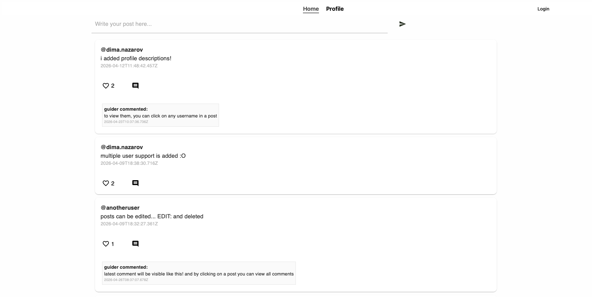
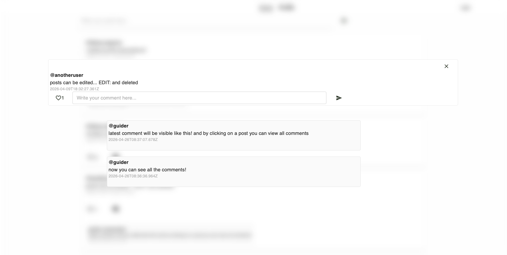
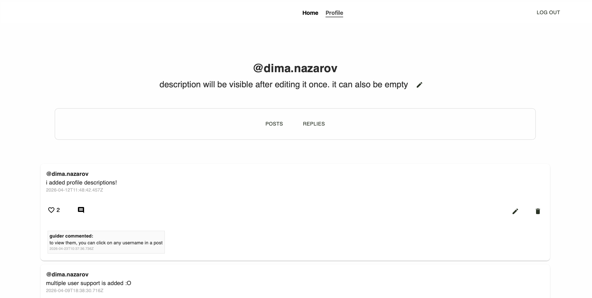
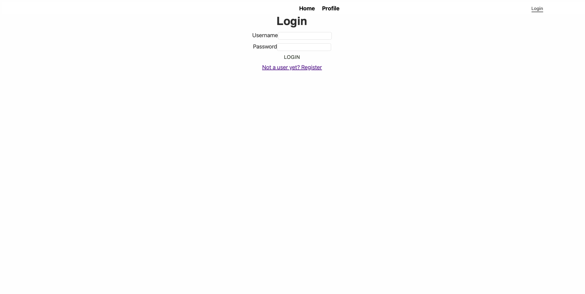
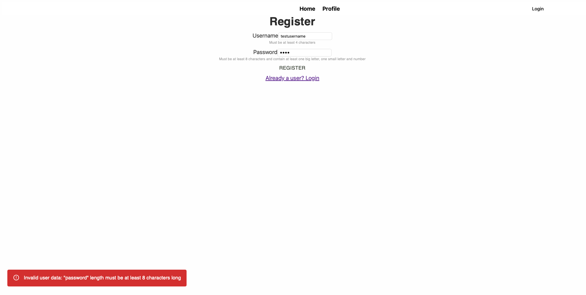

# Echo – text-based blog app

## Overview

**Echo** is a text based blog app where you can share, like and comment posts while
navigating a minimalistic UI using MUI package. In individual profile sections you can view all
posts or comments done by the person.

[Check it out here! (live demo)](https://echo-fullstack-blog-app.onrender.com)

This app showcases my skills in **fullstack programming** and enthusiasm towards
creating a polished project.

Project is done as a part of learning on a second year fullstack course in
Tampere University of Applied Sciences.

## Build status

Every push of commits to GitHub is done considering that the app is working, but
not all individual commits contain a working project.
Stable releases with realised functionalities are better found in releases.

## Screenshots


(Home page)

(Individual post view)

(Profile view with description handling and ability to view users posts and comments)

(Profile view when not logged in)

(Login page)

(Register page and error message for invalid input. Similar to login error messages visually)

## Tech

- **Express.js**
- **Node.js**
- **PostgreSQL** on Render.com server
- **Docker**
- **React (Vite)**
- **JSDoc**
- **Passport** + **Session** + **bcrypt**
- **Joi**
- **MaterialUI**
- **Jest** + **SuperTest**

## Link to the deployed project

[Check it out here!](https://echo-fullstack-blog-app.onrender.com)

## Features

- All **posts** visible in the home page with the latest **comment** showcased
  directly under it
- Individual **post** view when clicking on a post to see all comments
- **Likes** to show appreciation for a post
- **Editing a post** directly in a post card
- **Profile view** to view all posts and comments made by user
- **Description** can be edited in profile to showcase to other users (opening other profiles in development still)
- **Authentication, login and registration** with Passport, Session and Bcrypt. No one can change other persons data
- **Input validation with JOI**
- **Descriptive error messages** (not yet visible in frontend)
- Minimalistic and clean UI using **Material UI**
- All endpoints tested with **Jest + Supertest**

## Using project without installastion

This project doesn't require installation and is fully hosted on Render.com
[here](https://echo-fullstack-blog-app.onrender.com).

## Installation to run locally

1. Open a terminal and go to the `container` folder:
   ```
   cd container
   ```
2. Install dependencies for both frontend and backend:
   ```
   npm install
   ```
3. Create a Postgres database.

   > For local database configuration, copy `container/backend/.env.example` to
   > `container/backend/.env` and fill in your database values. Session secret can
   > be randomly generated

4. Start the app locally:
   ```
   npm run start
   ```

This runs the frontend with Vite and the backend together.
App will create the tables by itself on first initialization.

5. EXTRA STEP (if mock data is needed there is insertData.js script in backend/database/ folder)
   > By running it you create some guiding and mock posts, likes and comments with three accounts

## Database structure

```

        /---------------------\       /---------------------------------\
        | **users**           |       |        /--------------------\   |
    /-->| id          (PK)    |<------/        | **comments**       |   |
    |   | username            |                | id          (PK)   |   |
    |   | password            |                |                    |   |
    |   | description         |                |                    |   |
    |   \---------------------/          /---->| post_id     (FK)   |   |
    |                                    |     | user_id     (FK)   |---|
    |                                    |     | body               |   |
    |   /---------------------\          |     | created_at         |   |
    |   | **posts**           |          |     \--------------------/   |
    |   | id          (PK)    |<---------|                              |
    |   | user_id     (FK)    |          |     /--------------------\   |
    |   | body                |          |     | **likes**          |   |
    \---| created_at          |          \---->| post_id    (FK)    |   |
        \---------------------/                | user_id    (FK)    |---/
                                               \--------------------/
```

## AI Usage & Tutorial help

AI has been used through this project for debugging purposes especially in frontend
and searching for typos in routing. AI has been also used to describe concepts and
to help with SQL join queries and Jest + Supertest testings debugging.
While creating authentication logic AI was used to explain the theme and tools
available. Also debugging authentication with AI.
Consulting with AI about grading in general terms to see where I'm heading.

AI has made InsertData.js files script with the data I've given it, to preserve data
between Render.com free database expirations.

Tools used:

- ChatGPT
- GitHub Copilot

During creation of authentication, login and registering logic these tutorials
and articles were helpful:

- [Release notes template to understand what is needed in them](https://gist.github.com/andreasonny83/24c733ae50cadf00fcf83bc8beaa8e6a)
- [Video I ended up using the most. Passport + Session + Bcrypt](https://www.youtube.com/watch?v=-RCnNyD0L-s&list=LL&index=3)
- [Some logic for individual post popup was found here](https://www.youtube.com/watch?v=Gy4G68WoHq4&t=940s)
- [Another video that was helpful to understand the context](https://www.youtube.com/watch?v=nI8PYZNFtac&list=LL&index=5&t=532s)
- [Article I used to understand React and Passport interaction](https://www.freecodecamp.org/news/react-passport-authentication/)
- [Snackbar for error and success messages tutorial](https://www.youtube.com/watch?v=bLp0uLaez_w&list=LL&index=2)
- [Jest testing tutorial](https://www.youtube.com/watch?v=FgnxcUQ5vho)
- [Jest + Supertest for Node server](https://www.youtube.com/watch?v=FKnzS_icp20&t=390s)
